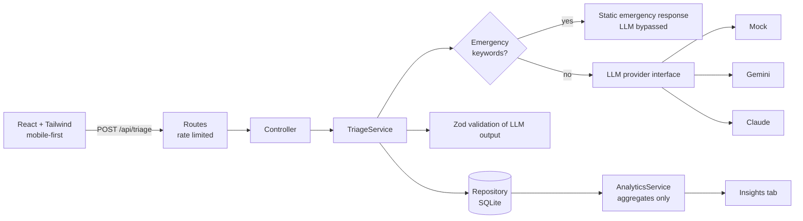

# Parentune Pulse

An AI triage tool for parents. Describe a worry in English, Hindi or Hinglish, add your child's age, and get:

1. **An urgency level**: emergency, see a doctor, ask the community, or manageable now
2. **A safe, instant first response** with practical steps and red flags
3. **A route forward**: talk to a doctor or ask verified parents

It mirrors Parentune's promise: trustworthy answers in minutes, 24x7.

**Live demo:** _add Netlify link_

## Architecture



Layers: `routes -> controllers -> services -> repositories`. Pure logic lives in `domain/`. The LLM sits behind an interface, so providers swap with one env variable and the service is testable with a fake.

## Key decisions

- **Safety first.** Emergency phrases (including Hinglish like "saans nahi") skip the LLM entirely and return a fixed "get help now" response. The prompt forbids diagnosis and dosing, and every answer carries a disclaimer.
- **Never trust LLM output.** Responses are parsed defensively and validated against a Zod schema before reaching the user. Parent text is passed as untrusted data inside delimiters.
- **Privacy.** Analytics expose aggregates only. There is no public endpoint that lists raw parent concerns.
- **Provider-agnostic.** `LLM_PROVIDER=mock|gemini|claude`. Built on Gemini's free tier, with Claude supported.
- **Abuse protection.** Rate limit of 10 triage requests per minute per IP, input size limits, strict validation.

## Run locally

Requires Node 22+.

```bash
# backend
cd server
cp .env.example .env     # set LLM_PROVIDER and the matching API key
npm install
npm test
npm run dev              # http://localhost:4000

# frontend (second terminal)
cd client
npm install
npm run dev              # http://localhost:5173
```

## Environment variables (server)

| Name | Purpose |
|---|---|
| `LLM_PROVIDER` | `mock`, `gemini` or `claude` |
| `GEMINI_API_KEY`, `GEMINI_MODEL` | Gemini provider |
| `ANTHROPIC_API_KEY`, `ANTHROPIC_MODEL` | Claude provider |
| `CORS_ORIGIN` | Allowed frontend origin |
| `DB_PATH` | SQLite file path |

## Known limitations and next steps

- This is general guidance, not medical advice, and it is a prototype.
- SQLite on a free host resets when the instance is rebuilt. Production would use Postgres.
- The "Talk to a doctor" and "Ask parents" buttons are placeholders for Parentune's real doctor and community flows.
- Next: a feedback loop (was this helpful?), clinician-reviewed prompt evaluation set, and a retrieval layer over Parentune's verified content.

## How this was built

Built with AI coding agents under my direction. See [PROMPTS.md](PROMPTS.md) for the prompts, what went wrong, and how I corrected it.
